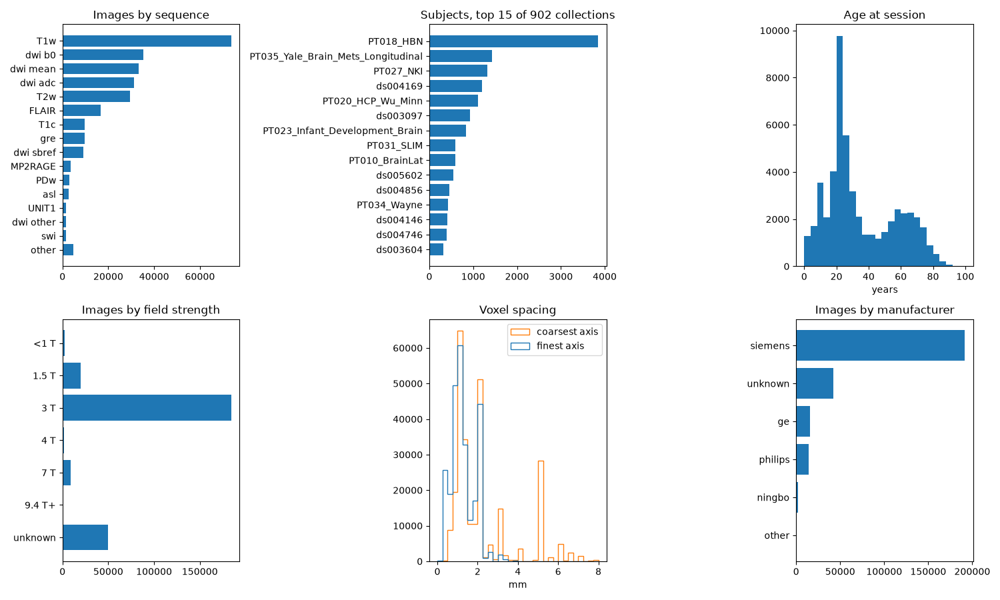

# FOMO300K (pretraining)

A brain MRI collection for self-supervised pretraining: 266,450 images from 47,404 subjects and 902 collections, research and clinical scans of many sequences. We take FOMO300K, drop every collection that shares subjects with our evaluation datasets, and store each image masked to the brain and cropped, at native resolution. No benchmark task uses it.

- **Homepage:** <https://huggingface.co/datasets/FOMO-MRI/FOMO300K>
- **Source:** the FOMO300K hub repo, one zip per session, downloaded with `huggingface_hub`. The repo is gated: accept its terms (including the HCP WU-Minn Data Use Terms) first.
- **Version:** v1.1, revision `0ea0b15cfcc08a96b7b9fd43d952cec3fdb7cfc7`.
- **DOI:** none. Paper: [arXiv:2506.14432](https://arxiv.org/abs/2506.14432).
- **License:** CC BY-NC-SA 4.0 for the collection. Each collection keeps its own license, listed in its folder of the FOMO300K repo. The HCP WU-Minn collections (PT019, PT020) are under the [HCP Open Access Data Use Terms](https://www.humanconnectome.org/study/hcp-young-adult/document/wu-minn-hcp-consortium-open-access-data-use-terms), which allow redistributing derived data under the same terms. If you use HCP data, cite it and add the acknowledgement those terms require.
- **Citation:** Cerri, S., Munk, A., Llambias, S. N., et al. (2026). A large-scale heterogeneous 3D magnetic resonance brain imaging dataset for self-supervised learning. arXiv:2506.14432. Also follow the attribution terms of each collection you use (see the paper's Usage Notes).
- **Code:** [`scripts/fomo300k/`](https://github.com/MedARC-AI/brainmarks-smri/tree/main/scripts/fomo300k) filters the sessions, preprocesses the images and builds `tables/` and `shards/`.

## Images

| sequence | images | sessions | subjects | collections | ≤ 1 mm |
|---|---|---|---|---|---|
| T1w | 73,626 | 60,602 | 45,682 | 871 | 79% |
| MP2RAGE (+ UNIT1, T1map) | 5,592 | 1,514 | 1,199 | 23 | 95% |
| T1c | 9,675 | 9,505 | 1,800 | 15 | 14% |
| T2w | 29,494 | 22,834 | 13,989 | 202 | 52% |
| FLAIR | 16,565 | 15,977 | 6,322 | 28 | 10% |
| PDw | 2,952 | 1,681 | 1,553 | 19 | 89% |
| GRE / SWI / T2* | 12,059 | 1,586 | 1,141 | 18 | 17% |
| angio | 810 | 683 | 557 | 11 | 63% |
| ASL | 4,750 | 2,732 | 1,745 | 12 | 1% |
| DWI b0 | 35,428 | 19,334 | 14,470 | 114 | 0% |
| DWI shell mean | 33,395 | 12,954 | 10,715 | 114 | 5% |
| DWI trace ADC | 31,183 | 11,786 | 9,726 | 101 | 5% |
| DWI SBRef / other | 10,740 | 3,084 | 2,391 | 19 | 7% |
| other | 181 | 72 | 65 | 10 | 14% |
| total | 266,450 | 68,330 | 47,404 | 902 | 34% |

≤ 1 mm: voxel spacing at most 1 mm on every axis. FOMO splits each 4D DWI run into a b0 and, per shell, one 3D image: either the mean of three axis-aligned volumes or a trace ADC. `dwi_type` in the table says which.



Age is known for 77% of sessions (median 26 years), sex for 78%. 74% of subjects come from 875 OpenNeuro datasets. Tumor sessions are mostly Yale brain metastases (1,430 subjects); no glioma collections remain.

## Collections left out

Every collection that shares subjects with an evaluation dataset is dropped whole: 11,330 subjects and 39,709 scans (13% of FOMO300K).

| FOMO300K collection | Shares subjects with |
|---|---|
| PT005_ADHD_200 | ADHD-200 |
| PT021_IXI | IXI, OpenBHB |
| PT028_OASIS1, PT029_OASIS2 | OASIS-1, OASIS-2 |
| PT009_BraTS-GEN, PT015_MSD_BrainTumor | BraTS 2021, UCSF-PDGM, UPENN-GBM |
| PT014_CoRR, PT016_GSP | OpenBHB |
| PT030_OpenNeuro/ ds000221, ds002330, ds002345 | OpenBHB |
| PT030_OpenNeuro/ ds000030, ds004889 | CNP, SOOP |

## Preprocessing

Per image of the kept sessions:

1. Brain mask with SynthStrip, also on images that are already skull-stripped.
2. 12-parameter affine from the image to MNI152NLin6Asym (ANTs), as for the evaluation datasets.
3. QC: Dice of the registered mask with the template brain mask, linear scale of the affine, brain volume. Out-of-range values are listed in `warnings` (12,704 images). Nothing is excluded on QC: filter as you need.
4. The stored image: the source image times the mask, cropped to its nonzero voxels, on the native grid. Values are stored as int16 times a scale (1 for integer images within the int16 range).

48 images failed (43 in SynthStrip, 5 in ANTs) and are left out.

## Contents

`shards/fomo300k-NNNN.zip`: 1000 uncompressed zip shards (0.4-1.2 GB, 692 GB in total) of whole sessions. Paths follow the source zips, `derivatives/<collection>/<subject>/<session>/<modality>/<stem>`:

- `<stem>.npz`: the stored image (fields below).
- `<stem>_mask.nii.gz`: brain mask on the source grid.
- `<stem>_mni.txt`: 4×4 affine (`np.loadtxt`) from image world coordinates (RAS mm) to MNI152NLin6Asym.
- `<stem>_info.json`: QC, source geometry and brain intensity statistics (also in `images.parquet`).
- `<stem>_{sag,cor,ax}.jpg`: 224 px thumbnails, rigidly aligned to the template.
- `session.json`: per session, the number of processed images.

npz fields (`np.load`, no compression):

- `values`: int16, the nonzero voxels in C order. The image is `values * scale`.
- `scale`: float64.
- `mask_rle`: uint8 run lengths of the nonzero mask over the flattened volume, alternating zero and nonzero runs and starting with zeros. Runs longer than 255 are split by zero-length runs of the other value.
- `shape`, `affine`: the cropped grid (the source affine, shifted by the crop).
- `mni_affine`: the same affine as `_mni.txt`.

`tables/`:

- `images.parquet`: one row per image. Identity (`path` as in the source zips, `collection`, `subject`, `session`, `modality`, `suffix`, `dwi_type`, `source_path` in the original collection); FOMO's participant and scanner metadata (`age`, `sex`, `handedness`, `group`, `field_strength`, `manufacturer`, `model_name`, sequence parameters as given, with mixed units); our QC (`brain_volume` in litres, `mni_scale`, `template_dice`, `warnings`); source geometry (`dtype`, `orientation`, `shape`, `spacing`, `mask_extent`); brain intensity statistics (`min`, `max`, `mean`, `std`, quantiles `q0.001` .. `q0.999`).
- `shards.parquet`: one row per shard member: `path`, `shard`, `offset` (start of the member's data in the zip), `size`, `sha256`.

## Usage

```python
import io

import numpy as np
import pandas as pd

root = "brainmarks-smri/fomo300k"
images = pd.read_parquet(f"{root}/tables/images.parquet")
members = pd.read_parquet(f"{root}/tables/shards.parquet").set_index("path")

# T1w images at 3 T, with no QC warnings.
selected = images[(images.suffix == "T1w") & (images.field_strength == 3) & (images.warnings.map(len) == 0)]

# Read one stored image by its offset in the shard.
stem = "derivatives/" + selected.path.iloc[0].removeprefix("source/").removesuffix(".nii.gz")
member = members.loc[f"{stem}.npz"]
with open(f"{root}/{member['shard']}", "rb") as shard:
    shard.seek(member["offset"])
    fields = np.load(io.BytesIO(shard.read(member["size"])))

mask = np.repeat(np.arange(len(fields["mask_rle"])) % 2 == 1, fields["mask_rle"])
image = np.zeros(fields["shape"], np.float32)
image[mask.reshape(fields["shape"])] = fields["values"] * fields["scale"]
```

Seeking to the offset is about twice as fast as opening the zip for every read. To work with plain files, unzip the shards: `cd brainmarks-smri/fomo300k && unzip -q 'shards/*.zip'`.
